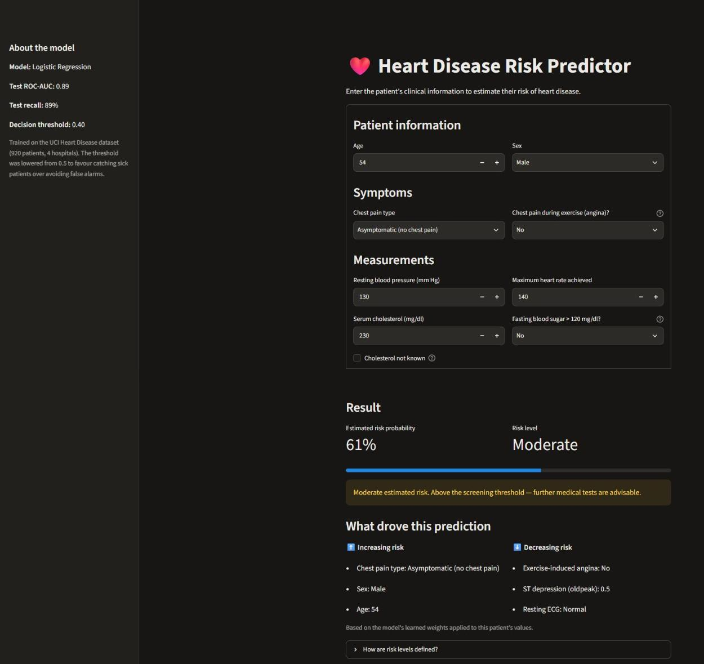
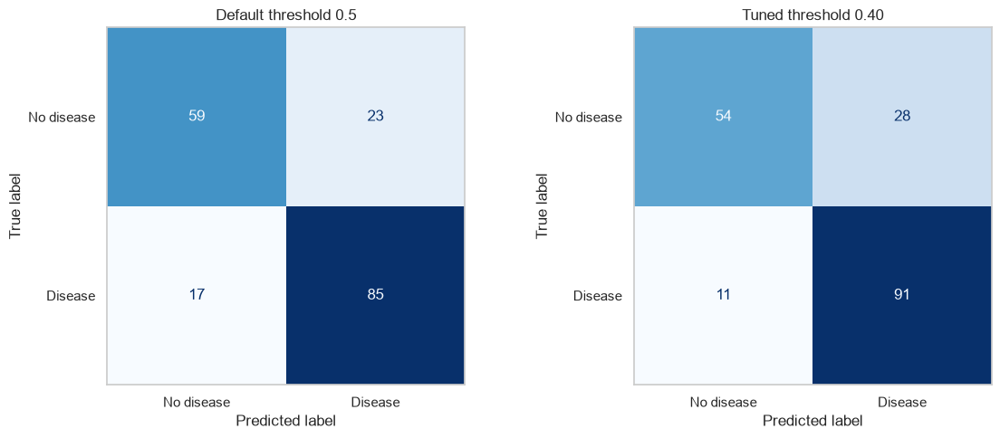
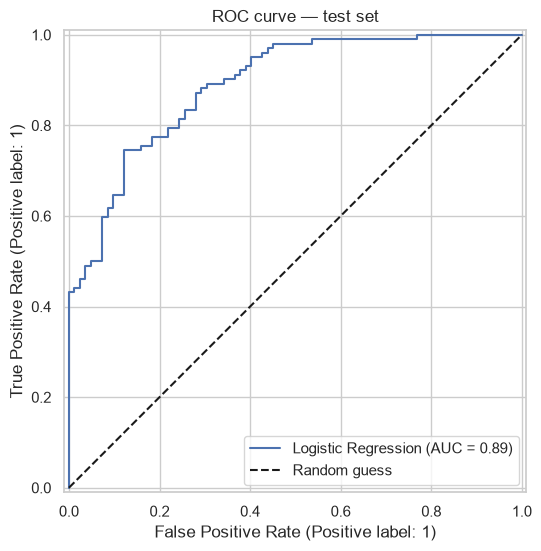

# ❤️ Heart Disease Risk Prediction

An end-to-end machine learning project that estimates a patient's risk of heart disease from routine clinical data, from exploratory analysis to a deployed web app.

**🔗 Live demo:** [heart-disease-risk-manan.streamlit.app](https://heart-disease-risk-manan.streamlit.app/)



---

## Highlights

- **0.89 ROC-AUC and 89% recall** on a held-out test set of 184 patients
- **Recall-oriented decision threshold** (tuned with cross-validation, not on the test set) that cuts missed diagnoses from 17 to 11 compared with the default 0.5 cut-off
- **Found and fixed two data-leakage problems** that would have inflated the scores (details below)
- Compared **Logistic Regression, Random Forest and XGBoost** with grid search and 5-fold stratified cross-validation
- **Interactive Streamlit app** that shows the risk probability, a Low / Moderate / High risk level, and the factors behind each prediction

## Tech Stack

Python · Pandas · NumPy · Scikit-learn · XGBoost · Matplotlib · Seaborn · Streamlit

---

## Dataset

[UCI Heart Disease dataset](https://archive.ics.uci.edu/ml/datasets/Heart+Disease) ([Kaggle mirror](https://www.kaggle.com/datasets/redwankarimsony/heart-disease-data)): **920 patients from 4 hospitals** (Cleveland, Hungary, Switzerland, VA Long Beach) with 13 clinical attributes. The original target `num` (0–4) was converted to a binary label: **disease present (55%) vs. absent (45%)**.

## Key Findings from the Data

**1. Cholesterol zeros are missing values in disguise.**
All 123 Swiss patients have a cholesterol of exactly `0`, which means it wasn't recorded. Because Switzerland also has a 93% disease rate, the raw data shows cholesterol as *protective* (correlation −0.23). Treating the zeros as missing flips it to +0.12, as expected medically.

**2. The hospital itself is a leakage risk.**
Disease rates range from 36% (Hungary) to 93% (Switzerland). A model given the hospital column would learn *where* a patient was examined, not *what* is wrong with them, so it was excluded.

**3. Missing values can leak the hospital too.**
After the app was built, testing showed that answering "unknown" for blood sugar **raised** the predicted risk from 50% to 84%. The cause: 75 of the 90 missing blood-sugar values belong to Swiss patients, so an "unknown" category had become a hidden "is Swiss" flag. The fix was to drop features whose missingness is concentrated in specific hospitals (`ca`, `thal`, `slope`) and to fill the remaining missing categories with the most frequent value. This cost about 1 point of ROC-AUC (within cross-validation noise) in exchange for a model that is actually valid.

## Modeling Approach

1. **Stratified 80/20 train/test split** made *before* any preprocessing, so the test set never influences imputation or scaling
2. **Scikit-learn `Pipeline`**: median imputation + scaling for numeric features, most-frequent imputation + one-hot encoding for categorical ones. The preprocessing and the model are saved together in a single file.
3. **Grid search with 5-fold stratified cross-validation** on the training set, selecting by ROC-AUC
4. **Threshold tuning** on out-of-fold training predictions, targeting ≥ 90% recall, because missing a sick patient costs more than a false alarm
5. **A single final evaluation** on the untouched test set

## Results

### Model comparison (5-fold cross-validation, training set)

| Model | ROC-AUC | Recall | Precision | F1 |
|---|---|---|---|---|
| **Logistic Regression** ✅ | **0.874** | 0.815 | 0.812 | 0.810 |
| Random Forest | 0.870 | 0.857 | 0.796 | 0.823 |
| XGBoost | 0.867 | 0.848 | 0.814 | 0.829 |

All three models score within about one standard deviation of each other. With roughly 740 training rows, the simpler **Logistic Regression performs as well as the tree ensembles** and is the easiest to interpret, so it was selected.

### Final test-set performance (Logistic Regression)

| Metric | Threshold 0.5 | **Tuned threshold 0.40** |
|---|---|---|
| ROC-AUC | 0.890 | 0.890 |
| Recall (sick patients caught) | 83.3% | **89.2%** |
| Precision | 78.7% | 76.5% |
| Missed sick patients | 17 | **11** |
| False alarms | 23 | 28 |

<p align="center">
  <br>
  
</p>

The test scores are in line with cross-validation (ROC-AUC 0.89 vs 0.87), which suggests the model generalises without overfitting.

---

## Project Structure

```
heart-disease-prediction/
├── app/
│   └── streamlit_app.py        # Web app
├── data/raw/
│   └── heart_disease_uci.csv   # Original dataset
├── models/
│   ├── heart_model.joblib      # Trained pipeline (preprocessing + model)
│   └── model_metadata.json     # Model info, threshold, CV and test metrics
├── notebooks/
│   ├── 01_eda.ipynb            # Exploratory data analysis
│   ├── 02_preprocessing.ipynb  # Cleaning & preprocessing pipeline
│   ├── 03_modeling.ipynb       # Model training & comparison
│   └── 04_evaluation.ipynb     # Test-set evaluation & threshold tuning
├── src/
│   ├── preprocess.py           # Cleaning rules and preprocessing pipeline
│   ├── train.py                # Grid search + cross-validation, saves the best model
│   └── evaluate.py             # Threshold selection + final test evaluation
├── requirements.txt            # App dependencies (used for deployment)
└── requirements-dev.txt        # + training & notebook dependencies
```

## Run It Locally

```bash
git clone https://github.com/Manan005/heart-disease-prediction.git
cd heart-disease-prediction
python -m venv .venv
# Windows: .venv\Scripts\activate    macOS/Linux: source .venv/bin/activate

# Run the app (uses the trained model in models/)
pip install -r requirements.txt
streamlit run app/streamlit_app.py

# Retrain and re-evaluate from scratch
pip install -r requirements-dev.txt
python -m src.train
python -m src.evaluate
```

## Limitations

- Small dataset (920 patients) collected decades ago from 4 hospitals, so it may not represent today's patient populations
- Three informative features (`ca`, `thal`, `slope`) were excluded because their missing values encode the hospital
- With only 184 test patients, the reported metrics carry a few points of uncertainty

## ⚠️ Disclaimer

This is an educational machine learning project, **not a medical device**. It must not be used for diagnosis or treatment decisions. Always consult a qualified healthcare professional.
